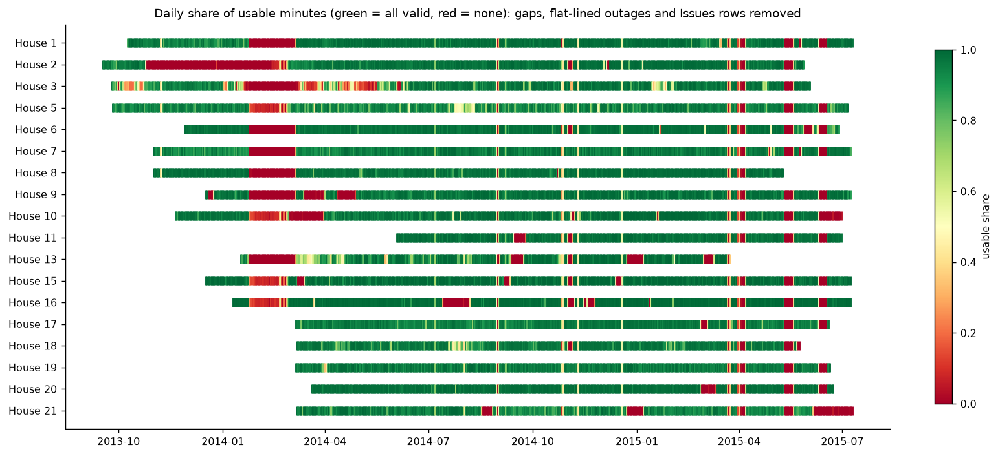
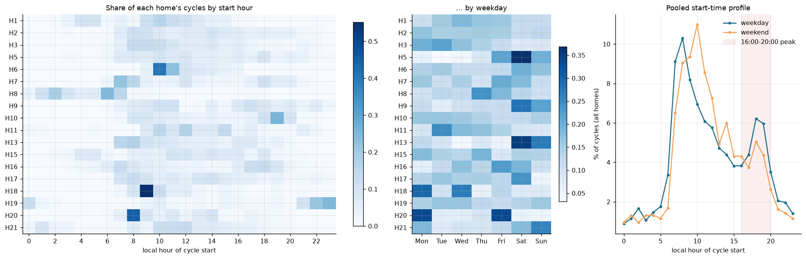
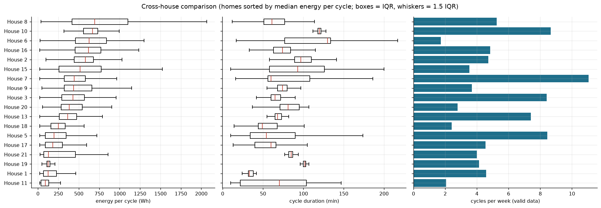
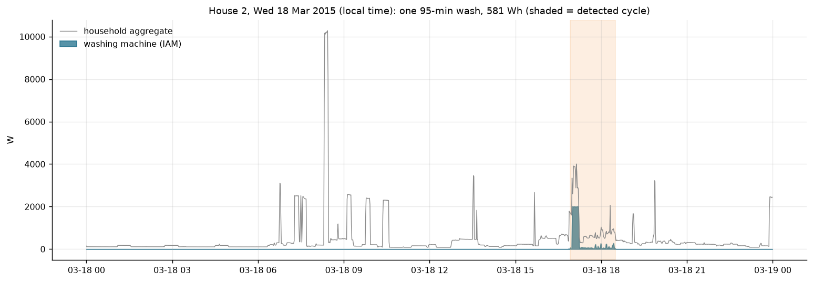
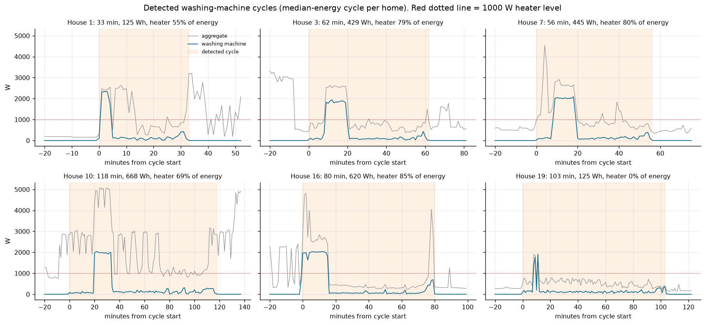
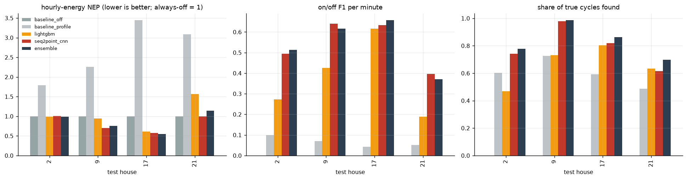
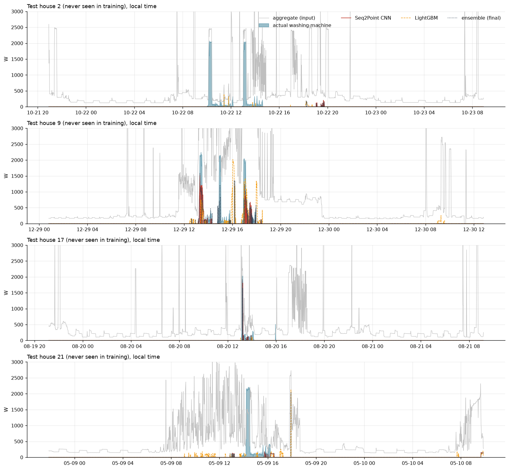
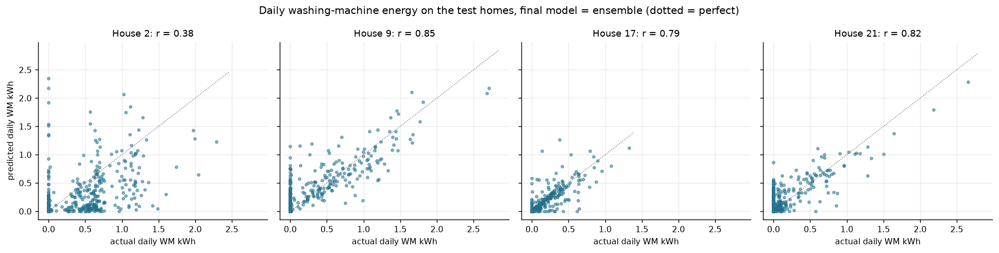
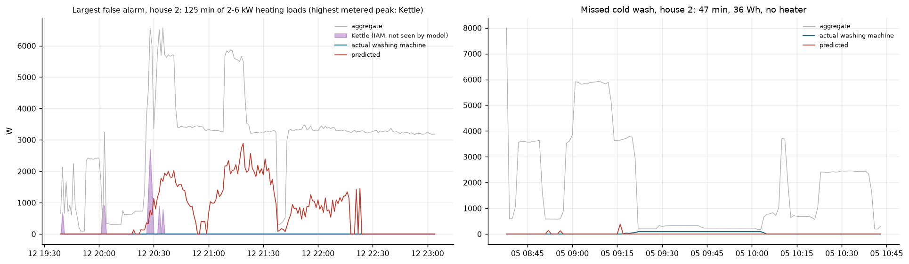

# RESULTS.md: washing-machine EDA, disaggregation model, validation and failure analysis

All numbers below are read from `outputs/tables/`, and every figure is in `outputs/figures/`. Both are regenerated by `run_all.py`. Data and cleaning decisions are described in [DATA.md](DATA.md).

---

## Part A: Exploratory analysis of washing-machine use (Section 2)

**Homes and periods.**
- **18 homes:** 1, 2, 3, 5, 6, 7, 8, 9, 10, 11, 13, 15, 16, 17, 18, 19, 20, 21.
- Each home is used over its full cleaned period, from Sep 2013 – Mar 2014 to May – Jul 2015 (392–648 days per home).
- Data are at 1-minute resolution, on true UTC, and analysed in UK local time.
- Only **valid** minutes are used. A valid minute has the aggregate and washing-machine (WM) value present, `Issues` = 0, and no flat-lined aggregate.

### A1. Availability and data quality

Source: `s2_availability.csv` and figure `s2_01_availability.png`.

| | Median across homes | Range |
|---|---|---|
| Valid minutes | 83% | 71.5% (H3) – 89.3% (H19, H20) |
| Missing timestamps | 11% | 5.8% – 24.6% (H2) |
| Flat-lined aggregate (hidden outage) | 1.1% | 0.1% – 11.7% (H3) |
| `Issues` flag | 1.9% | 0.8% – 7.6% |
| WM exactly 0 W | 94% | 53% (H5, which idles at 3 W) – 99% |
| WM active (> 20 W) | 2.5% | 1.0% – 8.6% |
| **Detected cycles** | **5,941 in total**; 100 (H11) – 803 (H7) per home | |
| Cycles per week | 4.6 | 1.7 – 11.0 |
| WM share of household electricity | 2.3% | 0.4% – 6.0% |

*Interpretation:* every home has usable data for most of its period. Gaps cluster in **February 2014**, the outage the readme documents, and in spring 2015. House 3's red stripes are flat-lined stretches: the official file forward-filled over an outage. They would look like real constant load if they weren't removed.

### A2. Rule for an active washing-machine cycle

In plain language:

> The machine is **running** in any minute it draws more than **20 W**. Off and standby are 0–5 W, and a running drum motor is 50–300 W. Running minutes separated by quiet spells of **up to 30 minutes** count as **one wash**, because machines pause while soaking, draining and between rinse and spin. A wash must last **at least 10 minutes and use at least 20 Wh**. Anything smaller is the display, the door lock or a sensor blip.

A minute above **1 kW** is counted as the water-heating element.

**Sensitivity** (`s2_rule_sensitivity.csv`): the total cycle count changes by −7% to +4% for any threshold from 10 to 50 W combined with any pause from 20 to 60 minutes. Only a 10-minute pause changes it much (+12%), because it splits long soak phases into separate "washes". The rule is not fragile.

### A3. Usage patterns by hour and weekday

Source: `s2_hour_share.csv`, `s2_dow_share.csv` and figure `s2_05_usage_patterns.png`.

- **Weekdays have a morning peak at 07:00–09:00**, which holds 28% of weekday starts, and a **second, smaller peak at 18:00–19:00** (12%).
- **Weekends shift later**, peaking at **10:00** (11% of weekend starts).
- Saturday is the busiest day: 18.2% of cycles, against 14.3% for an even spread.
- **19.5% of cycles start, and 20.4% of WM energy is used, between 16:00 and 20:00**, the GB distribution-network peak.
- **Homes differ a lot:**
  - House 10 starts 43% of its washes in the evening peak, and House 16 39%.
  - House 8 starts almost every wash **between 01:00 and 06:00**. That pattern suggests a timer on an off-peak (Economy 7) tariff.
  - House 19 washes late in the evening (22:00–00:00).
  - Houses 5 and 13 wash mostly on Saturdays.

  So "the typical household" hides very different schedules, which is the reason to target homes individually.

### A4. Cycle characteristics across homes

Source: `s2_cycle_stats_by_house.csv` and figure `s2_04_cross_house.png`.

| | Pooled median | Lowest home | Highest home |
|---|---|---|---|
| Energy per cycle | **394 Wh** | 89 Wh (H11) | 693 Wh (H8) |
| Duration | **71 min** | 33 min (H1) | 130 min (H6) |
| Peak power | **2.07 kW** | 0.36 kW (H11) | 2.33 kW (H8) |
| Heater share of cycle energy | **76%** | 0% (H11, H19) | 89% (H8) |

*Interpretation:*
- **Heating the water is three quarters of a wash's electricity.** The motor, pump and spin are the rest.
- Energy per cycle varies **8×** between homes. That spread comes from wash temperature, not machine size.
  - Houses 11 and 19 almost never heat: 76% of their cycles have no heater phase, at ~90–125 Wh per cycle.
  - House 21 washes cold in summer and hot in winter. Its quarterly median peak goes 2.1 kW → 0.35 kW → 2.1 kW (checked per quarter during the analysis).
- Low-temperature washing is therefore **already practised by some UK households**. That makes it a realistic behaviour to encourage.

### A5. Required plots

**(i) Representative 24 hours: aggregate and washing machine.** Source: `s2_02_representative_24h.png`.

House 2 on a weekday, showing a 95-minute wash of 581 Wh, close to the home's median.
- The heater block at the start, ~2 kW for ~15 minutes, is the only part that stands out in the aggregate.
- The remaining 80 minutes of drum and spin (50–300 W) sit underneath kettles, cooking and other loads.
- This is the core disaggregation difficulty: **most of a wash's duration is nearly invisible in the aggregate. Most of its energy is not.**

**(ii) Detected cycles.** Source: `s2_03_detected_cycles.png`, which shows the median-energy cycle of six homes.

- The rule captures the whole programme in every case: fill, heat, wash, rinse and spin.
- Heaters come on at different points. In House 10 the heater starts 20 minutes in, after a cold fill and pre-wash. In House 1 it starts at minute 1.
- House 19's cycle has no heater at all.
- Spin bursts at the end reach 300–700 W.

**(iii) Cross-house comparison.** See A4 above: the energy per cycle, duration and cycles per week of all 18 homes.

---

## Part B: Disaggregation model (Section 3)

### B1. Task, homes and periods

The task is to estimate **washing-machine power in each minute** from the **household aggregate alone**, at 1-minute resolution. The data are the official cleaned files, with the clock corrected and only valid minutes used.

| Split | Homes | Valid minutes | WM-on minutes | Period (UTC) |
|---|---|---|---|---|
| Train | 1, 3, 5, 6, 7, 8, 10, 11, 13, 16, 18, 19 | 7,715,618 | 294,069 | Sep 2013 – Jul 2015 |
| Validation | 15, 20 | 1,280,116 | 26,834 | Dec 2013 – Jul 2015 |
| Test | 2, 9, 17, 21 | 2,436,427 | 59,620 | Sep 2013 – Jul 2015 |

### B2. Validation design and why it avoids leakage

- **Homes are split whole.** A minute's input is a 99-minute window, so neighbouring minutes share 98% of their input. A random split would put almost identical windows in train and test, and the model would score well by memorising.
- **A time split inside each home would still leak the home itself**: its machine, its base load and its habits. A utility wants the opposite, a model that works in a home that has no sub-meter.
- **Validation homes alone** choose the CNN epoch (best of 12 by validation NEP; epoch 6 was selected), the LightGBM tree counts (early stopping), the on/off gate thresholds, the ensemble weight, and which model is "final".
- **Test homes are scored once, at the end.** Nothing was tuned on them.
- The test homes were picked to include realistic confusers:
  - a dishwasher (H2, H21);
  - a washer-dryer next to the washing machine (H9);
  - tumble dryers (H17, H21);
  - seasonal cold washing (H21).

### B3. Models

| Model | Description |
|---|---|
| `baseline_off` | Always 0 W, the "do nothing" reference |
| `baseline_profile` | Mean WM power by local hour × weekday/weekend, from the train homes (a usage-profile baseline) |
| `lightgbm` | Gated LightGBM (a classifier for p(on) plus a Huber regressor for power) on 40 rolling-window features of the aggregate. The top features are step counts in a 99-minute window, the current aggregate, hour of day and short-window variability (`s3_lightgbm_feature_importance.csv`). |
| `seq2point_cnn` | Seq2Point CNN (Zhang et al., 2018) with a 99-minute window and 130k parameters, and a power head plus an on/off gate head (Shin et al., 2019). Input channels are the aggregate and the aggregate minus the window minimum, which removes each home's base load. Training uses balanced sampling with hard negatives (Kelly & Knottenbelt, 2015). |
| `ensemble` (**final**) | 0.75 × CNN + 0.25 × LightGBM for both p(on) and power, with a gate at 0.5. The weight and threshold were chosen on validation. It had the best validation NEP: 0.532, against 0.545 for the CNN and 0.914 for LightGBM. |

### B4. Metrics and why they are useful

| Metric | Why |
|---|---|
| **NEP** = Σ\|error\| / Σ actual (per minute) | The standard NILM energy-error metric. Always-off scores exactly 1, so values below 1 mean the model helps. It is strict: a correct 15-minute heater block predicted 5 minutes late counts twice. |
| **Hourly and daily NEP** | The same metric after summing to local hours or days. This is the resolution at which a bill, an app insight or a demand-response programme would use the estimate. |
| **Total energy error** | Bias over the whole test period. It answers "how much did washing cost this home?" |
| **On/off F1 (minute)** | Timing accuracy of "the machine is running" |
| **Cycle recall, precision and F1** | Event-level: did the model find each wash, and is each predicted wash real? This is what counting washes or sending "you washed at peak time" messages needs. |
| **Daily energy correlation** | Whether the model tracks day-to-day variation |

**MAE in W is reported but not used to choose models.** Because the machine is off 97% of the time, always-off already has a tiny MAE (10.4 W), so MAE rewards doing nothing.

### B5. Results on the unseen test homes

Source: `s3_test_summary.csv` (pooled over the 4 test homes) and `s3_test_by_house.csv`.

| Model | NEP (minute) | **Hourly NEP** | **Daily NEP** | Total energy error | On/off F1 | **Cycles found** | Cycle precision | **Cycle F1** | Daily r |
|---|---|---|---|---|---|---|---|---|---|
| Always-off | 1.000 | 1.000 | 1.000 | −100% | 0.00 | 0% | – | – | – |
| Usage profile | 2.414 | 2.337 | 1.455 | +52% | 0.07 | 60% | 16% | 0.25 | 0.08 |
| LightGBM | 1.087 | 1.013 | 0.852 | −52% | 0.33 | 65% | 45% | 0.53 | 0.48 |
| Seq2Point CNN | 1.003 | **0.861** | **0.637** | −7.5% | **0.53** | 79% | **55%** | **0.65** | 0.69 |
| **Ensemble (final)** | 1.030 | 0.885 | 0.650 | **+0.3%** | 0.53 | **83%** | 51% | 0.63 | **0.71** |

**Reading the table:**
- **Both learned models beat both baselines** on every event and energy metric.
- The usage profile shows why a profile isn't enough. It spreads a "typical" wash over every day, so it overestimates energy by 52% and produces about 3 false cycles per true one.
- **The CNN is clearly better than LightGBM.** It finds 79% of washes against 65%, cuts daily-energy error by about a third (0.64 against 0.85), and its total-energy bias is −7.5% against −52%. Learning the cycle shape from the raw window beats hand-built rolling statistics.
- **The final ensemble gets total washing energy right to within 0.3%** across the four homes, finds **83% of all washes** (89% of heated washes), and gives **daily washing-energy estimates 35% more accurate than always-off** (daily NEP 0.65).
- **Minute-level NEP is about 1.0** for every learned model. Minute by minute they are no better than always-off: being a few minutes early or late on a 2 kW block is penalised twice. The error halves when energy is summed per hour (CNN 0.86) or per day (0.64). **The model is useful for "how much and roughly when", not for exact minutes.**
- **Selection held up only partly on test.** The ensemble won on validation (NEP 0.532 against 0.545). On test it was better on energy bias, recall and daily correlation, and slightly worse than the CNN on minute, hourly and daily NEP. The difference between the two is small compared with the spread across homes, so I keep the model that was chosen before looking at test, rather than switching after seeing the results.
- **Validation and test differ: validation NEP 0.53 against test 1.03.** The validation homes have cleaner, mostly heated washes, while the test homes were chosen to be hard. House 2 also dominates the energy-weighted test NEP, because it has the most WM energy (183 kWh) and the model misses about 30% of it. One validation pair is not a reliable estimate of performance in a new home. The per-house spread below is the more honest picture.

**Per test home, final model:**

| House | Cycles (true / pred.) | Cycles found | Precision | Total energy error | Daily NEP | Daily r | Main difficulty |
|---|---|---|---|---|---|---|---|
| 2 | 305 / 439 | 78% | 59% | −30% | 0.72 | 0.38 | Kettle and dishwasher; 25% of timestamps missing |
| 9 | 234 / 494 | **99%** | 46% | +23% | 0.55 | **0.85** | Washer-dryer next to the WM causes over-prediction |
| 17 | 269 / 276 | 86% | **83%** | **+1.6%** | **0.42** | 0.79 | Tumble dryer; 16% cold washes |
| 21 | 218 / 487 | 70% | 32% | +45% | 0.84 | 0.82 | **49% cold washes**; pond pump, tumble dryer, dishwasher |

**Actual vs predicted, evaluation data.** Source: `s3_01_actual_vs_predicted.png`, which shows 36 hours around a median-energy wash in each test home.

- In House 9, the predictions sit on the actual heater blocks, and the drum-phase power is placed at roughly the right level.
- In House 17, the single wash is caught with the right shape.
- In House 2, one of the two clean 2 kW heater blocks is missed while other appliances run. The model is conservative when the aggregate is busy.
- In House 21, LightGBM fires on unrelated afternoon loads, and the CNN and ensemble mostly don't.

**Daily energy.** Source: `s3_02_daily_energy_scatter.png`.

Daily washing energy is tracked well in Houses 9, 17 and 21 (r = 0.79–0.85). House 2 is the weak home (r = 0.38). Many of its wash days are predicted near zero.

### B6. Failure analysis

Sources: `s3_false_alarm_sources.csv`, `s3_recall_breakdown.csv` and figure `s3_04_failure_cases.png`.

**Failure 1: other heating loads become false washes.** About half of the predicted cycles in the test homes are false alarms (826 in total). To attribute them, I used the test homes' other plug monitors, which the model never sees. For each false alarm I took the metered appliance with the highest peak.

| Likely source during the false alarm | Share |
|---|---|
| No metered appliance ≥ 500 W, so an **unmetered** load (oven, hob, electric shower or immersion heater) | 48% |
| Kettle | 25% |
| Dishwasher | 20% |
| Tumble dryer, microwave, electric heater, washer-dryer | 7% |

- A dishwasher heats water with the same 2 kW resistive element and runs a similar programme, so a 1-minute aggregate can't separate the two reliably.
- The left panel of the figure shows the largest false alarm. It is an evening of 2–6 kW cooking or heating loads in House 2, about 3 hours long, with a kettle among them. The model reads repeated heater-like blocks as a wash.
- These false alarms **cluster at dinner time**. That matters for the peak-time use case (Recommendation.md).

**Failure 2: cold washes are hard to see.**

| | Cycles found |
|---|---|
| Heated washes (867) | **89%** |
| Cold washes, no heater (159) | **49%** |
| WM < 15% of household load during the wash | 76% |
| WM 15–50% of load | 87–88% |

- Without a heater, a wash is 50–300 W of motor and pump for an hour or more. That is about the size of a TV or fridge cycle, and it sits under everything else.
- House 21 washes cold half the time and has the lowest recall (70%).
- The right panel shows a typical missed cold wash: a 47-minute, 36 Wh wash under 3–6 kW of other load.
- This failure **grows as households adopt eco or 30°C programmes**, which is the behaviour the recommendation encourages. The model would then under-count washes after a successful campaign, so it must not be the only measure of that campaign.

**Other situations where it will struggle:**
- Washer-dryers on top of the washing machine (H9 over-predicts by 23%).
- Homes with large timestamp gaps (H2).
- Homes with a heat pump, EV or other large modulating load. None are in REFIT, so these would be out of distribution.

---

## Part C: What changes with 15- or 30-minute data (supports Section 4)

Source: `s4_resolution_experiment.csv`, from `src/coarse.py`.
- Same homes and split as Part B.
- One simple LightGBM regressor per resolution, with no gate and the same feature design at every resolution.
- These numbers compare **resolutions with each other**, not with the stronger Part B models.

| Resolution | Daily-energy correlation | F1 for "machine running in this interval" | Total energy error |
|---|---|---|---|
| 1 min | **0.53** | **0.30** | −22% |
| 15 min | 0.35 | 0.19 | +44% |
| 30 min | 0.35 | 0.16 | +59% |

- Going from 1 to 15 minutes **cuts daily tracking by a third and interval detection by about 40%**.
- The model can no longer keep energy unbiased (from −22% to +44%).
- The reason is that **a 2 kW, 15-minute heater block becomes one 15-minute average of a few hundred watts**. In a 30-minute interval the same block looks no different from a 1 kW oven or 2 kettle boils.
- The WM's share of an interval's energy when it is running drops from 17% to 15%. The signal is still there in aggregate, but its shape, the thing the CNN relies on, is gone.

---

## Part D: What I would do next, and why

1. **Leave-one-home-out over all 18 homes** (needs a GPU; one CNN fit costs about 1 hour on this CPU). Two validation homes and four test homes give a wide, uncertain estimate. LOHO would give a proper spread and a better selection set.
2. **Train with more varied data, and fine-tune on the target home.** D'Incecco et al. (2020) and the House 2 result both suggest cross-home transfer is the weak point. A few labelled weeks from a new home, or synthetic mixtures of known WM signatures on other homes' aggregates, usually help most.
3. **A cold-wash class.** Add a separate head, or train on synthetic cold cycles, so recall doesn't collapse as households adopt eco washes.
4. **Joint dishwasher and washing-machine model.** Predicting both together forces the model to assign each 2 kW heater block to one appliance, and directly attacks 20% of the false alarms.
5. **Cycle-level post-processing.** Merge or reject predicted cycles by duration and energy priors learned from Part A, such as "a wash lasts 30–150 minutes and has one heater phase". This should cut short kettle- and oven-triggered false cycles.
6. **Probability calibration and uncertainty per day**, so a utility can show "likely washed 3–4 times this week" rather than a single number.
